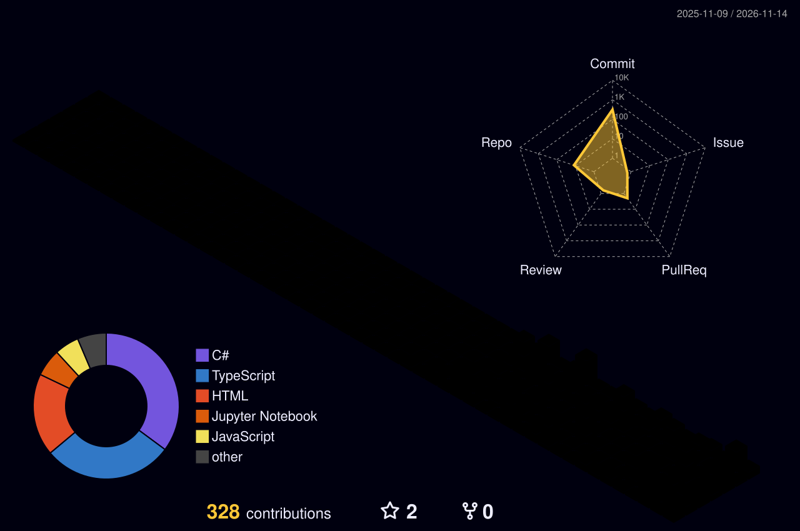

  

  

  

    <i>Building high-performance web applications, specialized POS solutions, and algorithmic trading models.</i>
  

  

    
    
    
  

---

<h3 align="center">🧪 Technical Focus & Core Skills</h3>

* 💻 **Full-Stack Web:** Building modern, reactive web applications using **Next.js**, **React**, **Svelte**, **Node.js**, **PHP/Laravel**, and **Tailwind CSS**.
* 📊 **Quant Research & ML:** Developing & backtesting algorithmic cryptocurrency trading models with **Python** (GRU/LSTM neural networks, ATR dynamic volatility thresholds, and slippage simulation).
* 🗄️ **Database & Backend:** Architecting and optimizing relational & cloud data systems with **PostgreSQL**, **Supabase**, and **MariaDB**.
* 🛠️ **Environment & Infrastructure:** Operating in terminal-centric Linux & Windows workflows utilizing **Git**, **Docker**, **VirtualBox**, and **Tailscale**.

---

<h3 align="center">🛠️ Tech Stack</h3>

  <b>Languages & Frameworks</b> 
  

  <b>Infrastructure, Databases & Tools</b> 
  

---

<h3 align="center">🏙️ 3D Contribution Skyline</h3>

  

<h3 align="center">📈 GitHub Pulse & Statistics</h3>

  
  

 

  

---

<h3 align="center">📌 Highlighted Builds</h3>

<table>
<tr>
<td width="50%" valign="top">

#### 🏬 [Oh My Cashier!](https://oh-my-cashier.vercel.app/)
Terminal-shell themed (`Oh My Zsh`) F&B Point of Sale PWA featuring table management, split bills, and Android Capacitor mobile pipeline.
 `PWA` `JavaScript` `Capacitor` `POS`

---

#### 📈 [Crypto Quant Research](https://quanttradingsystems.vercel.app/)
Python backtesting engine utilizing GRU/LSTM neural networks, ATR dynamic thresholds, and realistic slippage simulation for BTC models.
 `Python` `GRU/LSTM` `Quant` `Backtesting`

---

#### 🎲 [WNI Monopoly](https://monopoliwni-gas.vercel.app/)
Indonesian-themed digital Monopoly web game engineered for fast, responsive multiplayer sessions.
 `Svelte` `Tailwind CSS` `Vite`

---

#### 🌸 [Siklusku](https://github.com/zakiafuadi925-ops/siklusku)
Privacy-first, 100% client-side menstrual cycle tracker with zero external data tracking.
 `Vanilla JS` `Tailwind CSS` `Client-Side`

</td>
<td width="50%" valign="top">

#### 🥊 [Math Boxing WEB](https://math-boxing-web.vercel.app/)
Interactive real-time mathematical boxing game & logic challenge PWA with cloud leaderboard integration.
 `React` `Vite` `Tailwind` `Supabase`

---

#### 📊 [Personal Finance Tracker](https://personal-finance-tracker-rust-phi.vercel.app/auth)
Full-stack personal cashflow & analytics dashboard with interactive visualizations and secure authentication.
 `Next.js` `PostgreSQL` `Supabase` `Recharts`

---

#### 🏡 [Nama Living](https://nama-living.vercel.app/)
Modern furniture & interior design business showcase platform built with clean, responsive UI architecture.
 `React` `Tailwind CSS` `Vercel`

---

#### 🚀 [Explore More Repositories](https://github.com/zakiafuadi925-ops?tab=repositories)
Check out my other experiments in PHP/MariaDB POS systems, Linux automation scripts, and web architectures.
 `Open Source` `Full-Stack` `Systems`

</td>
</tr>
</table>

---

  
<i>"Data without analysis is just noise. Efficient code is the bridge to clarity."</i>

  
  

